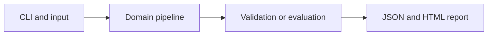

# Synthetic DNA Motif Classifier

Learn short-sequence statistics for an artificial motif recognition task without functional genomic claims.

**Category:** Biology / Sequence ML

**Execution:** Actual local algorithm or workflow; no external model service required.

## Run

```sh
python -m venv .venv
# Windows: .venv\Scripts\activate
# macOS/Linux: source .venv/bin/activate
python -m pip install -r requirements.txt
python app.py
python -m unittest discover -v
```

Open `results/report.html` after running. Python 3.10+ is required. Use `--help` for input and seed options.

## Architecture



## Algorithm

Generate random DNA strings and insert a short arbitrary tag in positive examples. Encode normalized dinucleotide frequencies and train a softmax classifier. Compare with direct tag matching to expose when a simple rule is better.

## Evaluation

Use independent generated sequence sets for training and test. Report ML classification metrics and exact-tag baseline performance.

## Limitations

The tag is an artificial label, not a promoter, binding site or pathogenic motif. Dinucleotide counts lose positional information and may underperform direct matching.

## Documentation

- [PDF project guide](PROJECT_GUIDE.pdf)
- [Editable guide](GUIDE.md)
- [Model and system card](MODEL_CARD.md)
- [Measured results](results/metrics.json)
- [Test output](TEST_RESULTS.txt)

## Extend it

Use a licensed regulatory-sequence benchmark, chromosome or homology-aware splits, reverse-complement handling and position-aware CNN or attention baselines.

AI-assisted educational project with synthetic data. Review, customize and explain your own contribution accurately. MIT license.

## Biology scope and current relevance

Default inputs are synthetic or project-authored. No clinical deployment or wet-lab validation is claimed. See [research context](RESEARCH_CONTEXT.md) and [data provenance](DATA_PROVENANCE.md).

- [AlphaGenome regulatory prediction research](https://www.nature.com/articles/s41586-025-10014-0) (2026)
